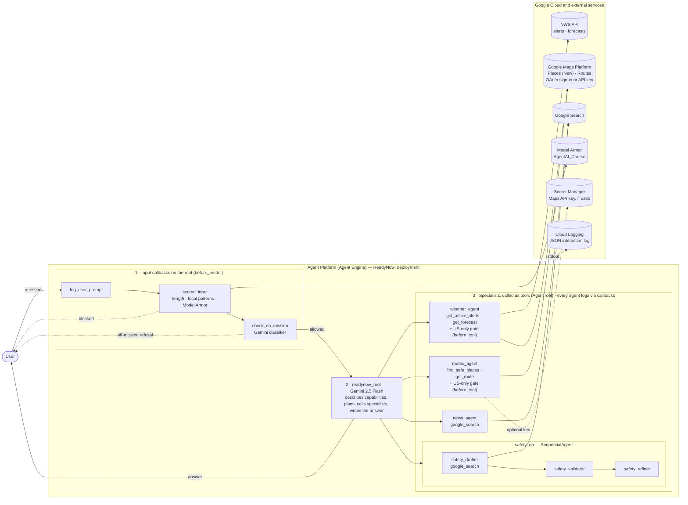
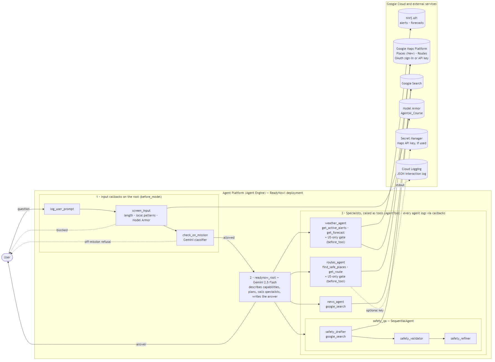

# ReadyNow! architecture

How a message flows: the root's input callbacks log it, screen it (local patterns + Model Armor) and check it is on-mission; the root agent then calls specialists as tools and writes one answer. Every agent logs each step as a JSON line, which Agent Platform sends to Cloud Logging. Google Maps (Places API (New) for geocoding and safe places, Routes API for directions) is called with Google Cloud OAuth, or with an API key when one is configured.

